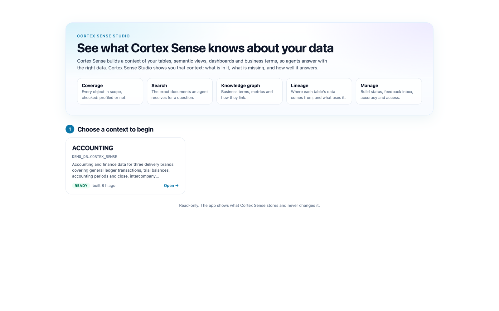
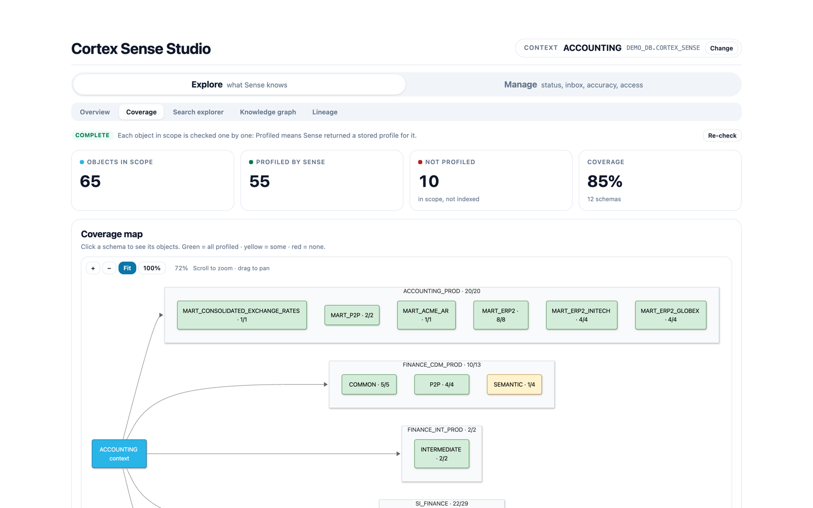
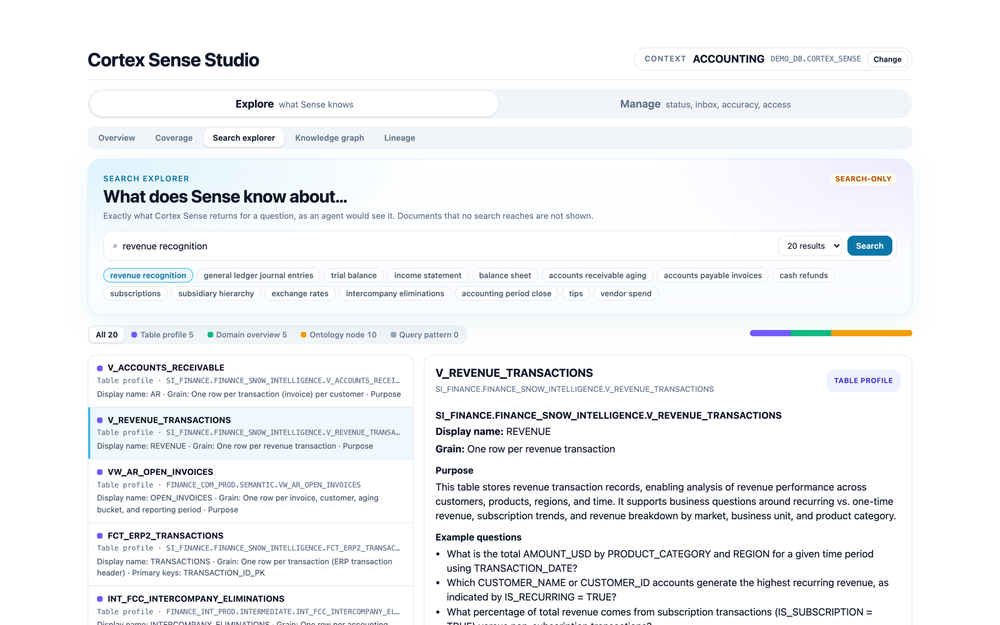
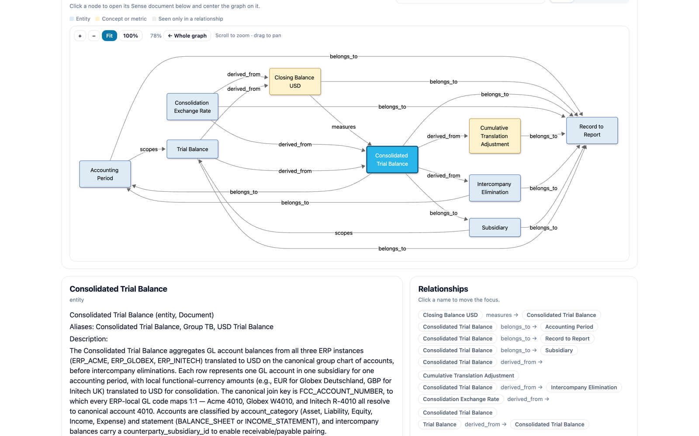
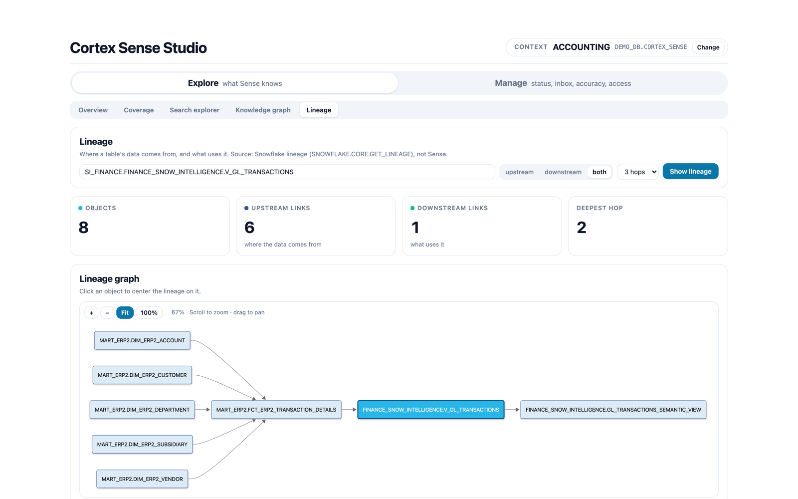
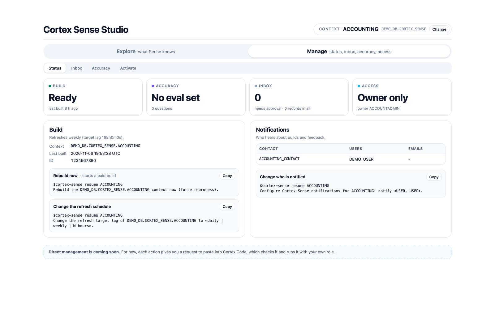

# Cortex Sense Studio

See what a [Snowflake Cortex Sense](https://docs.snowflake.com/en/LIMITEDACCESS/cortex-sense-reference) context
really holds: what it covers, what an agent gets back when it searches, and how its business terms link.
It is a React app that runs inside Streamlit in Snowflake.


[Watch the video with sound](docs/cortex-sense-studio-demo.mp4) (29 s). Music credit: [docs/music-credit.txt](docs/music-credit.txt).

> **Status.** This is a community sample. It is not an official Snowflake product and has no support.
> Cortex Sense is in limited access, and its functions can change. The screenshots show a real context
> with company, system and user names replaced.

Everything on screen comes from Cortex Sense without change. The app is read-only. It writes nothing to Snowflake.

## What you get

| | |
|---|---|
|  | **Start by choosing a context.** The app lists every Cortex Sense context your role can use. Nothing loads until you pick one. |
|  | **Coverage.** Every object in the context's scope is checked one by one: profiled by Sense or not. Click a schema, then an object, to open its stored profile. |
|  | **Search explorer.** The exact documents Sense returns for a question, as an agent would receive them. |
|  | **Knowledge graph.** Business terms, metrics and their relationships. Click a node to centre on it. |
|  | **Lineage.** Where a table's data comes from and what uses it (Snowflake lineage, not Sense). |
|  | **Manage.** Build status, feedback inbox, accuracy and access. Each action is a ready request for Cortex Code. |

## Sections

The app has two sections: **Explore** shows what Sense knows, and **Manage** shows the
context's status, the feedback inbox, accuracy (eval sets and runs) and who can reach it.

### Explore

| Tab | Shows | Complete? |
|---|---|---|
| Overview | The context at a glance: last build, refresh, and one card per scope source (tables, semantic views, dashboards, query history, ontology) | Complete |
| Coverage | A clickable map from the context to its schemas. Click a schema, then an object, to open its stored Sense profile | Complete for objects in scope |
| Search explorer | The exact documents Sense returns for a question: a result list with type filters, and the full document beside it | Search-only |
| Knowledge graph | Ontology entities, metrics and relationships. Click a node to center on it | Search-only |
| Lineage | Upstream, downstream or both (Snowflake lineage). Click an object to center on it | Complete, if the role has VIEW LINEAGE |

**Search-only** means the tab shows what Sense returns for the search terms. Sense has no
API that lists every document.

### Manage

| Tab | Shows | Actions |
|---|---|---|
| Status | Build state, refresh schedule, inbox and accuracy at a glance, notification contacts | Rebuild, change the schedule, change who is notified |
| Inbox | Every feedback record, with state filters and search | Approve, reject, remove, record a correction |
| Accuracy | The eval questions with their expected answers, and past runs with scores | Generate an eval set, start a run, compare runs |
| Activate | Who can reach the context | Create a CoWork agent or a Cortex Code skill, add to an agent, give a role access |

Manage only reads. Each action is a ready-to-paste request for Cortex Code, which checks it
and runs it with the user's own role. Direct actions in the app need restricted caller's
rights, and Cortex Sense builder actions do not run under it yet: the session drops the
`SNOWFLAKE.CORTEX_SENSE_BUILDER` role.

## Install with Cortex Code

Clone this repository, start Cortex Code in the folder, and paste:

```text
Read INSTALL.md in this repository and install Cortex Sense Studio in my Snowflake account.
Ask me for the names you need. Stop and ask before you create anything or run a GRANT.
```

The agent follows [INSTALL.md](INSTALL.md): it checks your tools and Cortex Sense access,
shows you the SQL, waits for your approval, deploys, and verifies. To install by hand, use "Deploy" below.

## Requirements

- A Snowflake account with Cortex Sense enabled, and at least one context you can use.
- [Snowflake CLI](https://docs.snowflake.com/en/developer-guide/snowflake-cli/index) for deploy.
- **Streamlit container runtime.** The warehouse runtime does not work: Snowflake rejects the Sense
  functions inside owner's-rights procedures.
- A compute pool, and a warehouse for queries.
- The app owner role needs:
  - USAGE on each Cortex Sense context to show
  - USAGE on the source databases and schemas (for Coverage)
  - VIEW LINEAGE on the account (optional, for Lineage)
- The app runs with the **owner's** rights. Every viewer sees what the owner role can see.

## Run locally

```bash
cd frontend && npm ci && npm run build && cd ..
SNOWFLAKE_DEFAULT_CONNECTION_NAME=<connection> STUDIO_WAREHOUSE=<warehouse> \
  streamlit run streamlit_app.py --browser.gatherUsageStats false
```

## Test

```bash
cd frontend && npm test                       # bundle, bridge and static checks
python -m pytest tests -q                     # bridge, parallel jobs, deploy, dependencies
APP_URL=http://localhost:8501 CHROME="<path to Chrome>" LINEAGE_FQN=<db.schema.object> npm run smoke
```

## Deploy

1. Run `setup.sql` once as ACCOUNTADMIN. Edit the names at the top first. It creates the
   app schema and compute pool, and grants the app owner role what it needs.
2. Deploy. You need the [Snowflake CLI](https://docs.snowflake.com/en/developer-guide/snowflake-cli/index)
   and a connection that uses the app owner role. Node is not needed: the built bundle
   `ui/sl_ui.js` is in the repo.

```bash
bash deploy.sh . <DB.SCHEMA.APP> --warehouse <WH> --container --pool <POOL> -c <connection>
```

`deploy.sh` uploads only the files in `deploy.manifest`, and then checks that the live
files match the local files byte for byte.

3. Open the app in Snowsight (Projects › Streamlit). The first start installs packages
   and takes a few minutes.

## Change the UI

The React source is in `frontend/src` (`index.tsx` holds the views, `ui.tsx` the styles and
shared pieces, `kit.tsx` the bridge to Python). After a change, rebuild the bundle with
`cd frontend && npm ci && npm run build`, and commit `ui/sl_ui.js` with the source.

## Repository layout

| Path | What it is |
|---|---|
| `streamlit_app.py` | The app: Cortex Sense calls, checks on every request, background jobs |
| `react_bridge.py` | The browser ↔ Python channel and the background-job runner |
| `ui/sl_ui.js` | The built React bundle (deployed) |
| `frontend/` | React source, build script, tests and the browser smoke test |
| `tests/` | Python tests |
| `setup.sql` | One-time account setup |
| `deploy.sh`, `deploy.manifest` | Deploy script and the exact list of files it uploads |
| `pyproject.toml`, `environment.yml` | Python dependencies |

## Limits

- **Search-only tabs.** Sense has no API that lists every document. Search explorer and Knowledge graph show what
  Sense returns for their search terms, and label themselves "Search-only".
- **Manage is read-only.** Builder actions such as approve, reject and rebuild fail under restricted caller's
  rights, because the session drops the `SNOWFLAKE.CORTEX_SENSE_BUILDER` role. The app shows a request to paste
  into Cortex Code instead.
- **Owner's rights.** Every viewer sees what the app owner role can see. Share the app with care.
- **Container runtime only.** The warehouse runtime rejects the Sense functions.
- **Cost.** The compute pool and the warehouse bill while they run.

## Refresh the screenshots

`frontend/capture.mjs` takes the screenshots from a running app. Set `MASK` to a private JSON file
(`{"replace": [[from, to]], "block": [word]}`) to rewrite names in the page before each shot. The script stops if
a blocked word is still on screen. Keep that file out of the repository.

## Contributing and security

See [CONTRIBUTING.md](CONTRIBUTING.md) and [SECURITY.md](SECURITY.md). The code is under the [Apache 2.0](LICENSE) licence.
